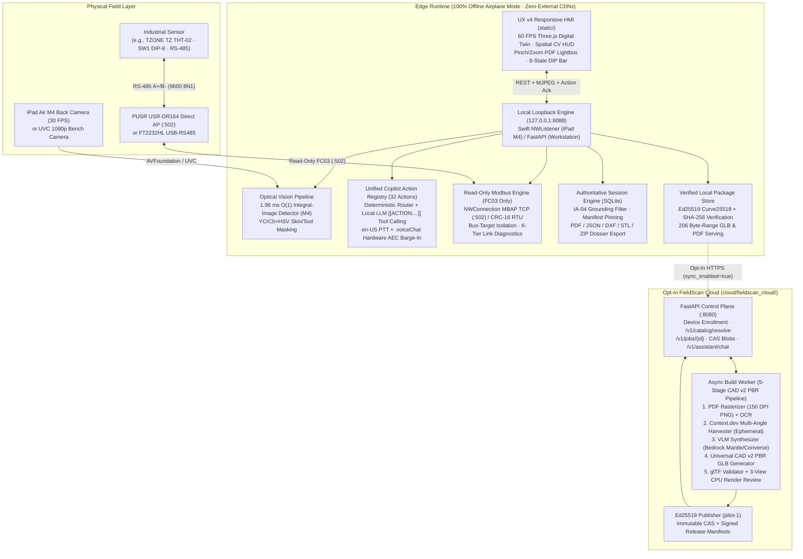
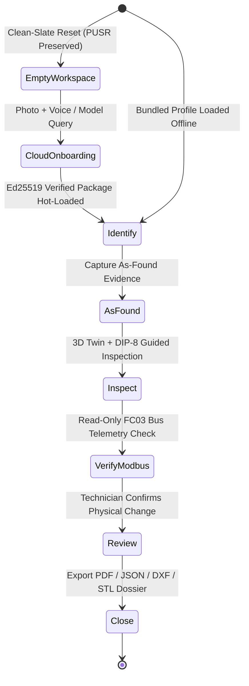
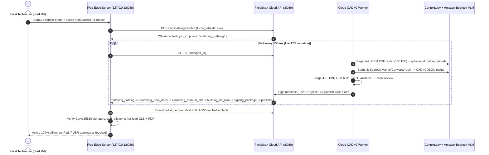

# FieldScan System Architecture

FieldScan is a dual-tier **Offline-First Edge + Opt-In Cryptographic Cloud** platform for industrial sensor inspection, 3D Digital Twin interaction, hands-free multimodal voice guidance, and read-only Modbus SCADA diagnostics.

---

## 1. End-to-End Architecture Overview

---

## 2. Edge Modularity & 1:1 Python ↔ Swift Parity

The Edge tier maintains a strict acyclic module graph (`scripts/audit_no_regressions.py` enforces zero circular imports) with 1:1 behavioral parity between the macOS/Linux Python reference implementation (`src/fieldscan/`) and the standalone native iPad Air M4 Swift application (`ios/FieldScanM4/`):

| Subsystem | Python Workstation (`src/fieldscan/`) | Native iPad Air M4 (`ios/FieldScanM4/`) | Responsibility |
|---|---|---|---|
| **HTTP / Voice Loopback** | `server.py` (FastAPI) | `StandaloneFieldScanServer.swift` (`NWListener`) | Loopback REST API (`127.0.0.1:8088`), MJPEG stream, PTT, Hands-Free `.voiceChat` Barge-In |
| **Multimodal LLM & Routing** | `lfm_engine.py`, `scene_and_chat_router.py` | `FieldScanConversationEngine.swift`, `LlamaServerBridge.swift` | On-device VLM (`Qwen3-VL-4B` / `LFM3` / Apple FoundationModels), `scene_vision`, tool-prompt injection |
| **Copilot Action Registry** | `copilot_registry.py` | `FieldScanCopilotRegistry.swift` | 32 bounded actions (`show`/`explain`/`propose`/`apply`), LLM `[[ACTION:...]]` parsing & validation |
| **3D Digital Twin Control** | `twin_controller.py` | `FieldScanTwinController.swift` | 6 canonical zones, DIP-8 binary weight solver (`128..1`), explode/rotate/X-Ray actions |
| **Datasheet Navigator** | `manual_navigator.py` | `FieldScanManualNavigator.swift` | SHA-256 verified manual lookup, section banners & fullscreen lightbox routing |
| **Optical Vision** | `video_scanner.py` | `FieldScanVisionDetector.swift`, `NativeCameraBridge.swift` | 30 FPS capture, carpet-proof integral-image probe lock (`< 2 ms` on M4), skin/tool masking |
| **Read-Only Modbus** | `modbus_tcp.py`, `modbus_rtu.py` | `ModbusTCPClient.swift` | Bounded MBAP TCP (`:502`), FT2232HL RTU CRC-16, `0x7FFF` fault sentinel, 6-tier link diagnostics |
| **Session & Compliance** | `session_engine.py`, `cad_builder.py`, `escalator.py` | `FieldScanSessionEngine.swift` | SQLite session state machine, `IA-04` grounding filter, PDF/JSON/DXF/STL dossier exports |
| **Cryptographic Store** | `catalog_store.py`, `catalog_client.py` | `FieldScanPackageStore.swift`, `FieldScanCatalogClient.swift` | Ed25519 + SHA-256 verification, anti-rollback, clean-slate workspace reset, Cloud polling |

---

## 3. Session Lifecycle & DIP-8 Guidance State Machines

### 8-State Physical DIP-8 Guidance Tracker
When guiding an operator through physical `SW1 DIP-8` reconfiguration (`#dipGuidanceBar`), the HMI enforces an 8-state progression (`preparing` -> `target_locked` -> `opening_housing` -> `dip_visible` -> `verifying_pins` -> `occluded_hold` -> `awaiting_confirm` -> `complete`) with occlusion debouncing, non-live camera rejection, and zero automatic bus-target mutation.

---

## 4. Unified Copilot Action Registry & Context Fencing

Every operator input channel — **LIVE Hands-Free Voice**, **Push-to-Talk**, **Text Chat**, and **Touch UI** — flows through the same bounded 32-action contract:

1. **Turn Context Capture:** Each turn stamps `turn_id`, `session_id`, `manifest_sha256`, `scene_generation`, `active_document_id`, and `language`.
2. **Deterministic Fast Path + Open-Ended LLM Tool Calling:** High-precision voice intents (PDF pages, DIP-8 views, clean-slate reset, cloud onboarding, PUSR config) resolve deterministically in milliseconds; open-ended requests inject the live action manifest into the local LLM so it emits validated `[[ACTION:<action_id>|{json}]]` directives.
3. **Sequential UI Receipts:** The frontend executes actions sequentially in `COPILOT_ACTION_HANDLERS`, verifies visual completion (e.g., lightbox image decoded, 3D scene updated), and posts `/api/copilot/action_ack` before releasing deferred TTS playback.
4. **Stale-Response Guard:** Monotonic `scene_generation` fencing prevents delayed replies from mutating a newer sensor workspace after a reset or package switch.

---

## 5. FieldScan Cloud 5-Stage Multimodal CAD v2 PBR Pipeline

When an operator encounters an unknown sensor in the field and opts in to Cloud onboarding:

### Key Cloud Design Invariants
- **8 Universal CAD v2 Primitives:** `lathe_profile`, `extruded_polygon`, `slotted_cylinder`, `hex_prism`, `rounded_box`, `tube_path`, `pattern`, and `composite_part` compiled with glTF 2.0 `PBRMaterial`, embedded Pillow `procedural_label` textures, and pure-NumPy crease-angle normals.
- **Deterministic Anti-Regression for Verified Fixtures:** Verified OEM recipes bypass nondeterministic VLM degradation during `force_refresh: true`, while newly discovered sensors invoke the full Bedrock Mantle/Converse multimodal synthesis pipeline with automatic image-cap contact-sheet tiling (`_pack_images_to_limit`).
- **Zero-Leak Storage:** Ephemeral reference images are deleted immediately after Stage 5; only OEM datasheet artifacts, generated `.glb` geometry, and signed JSON manifests are persisted in content-addressed storage (`CAS`).
