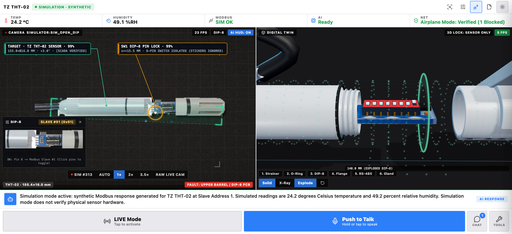
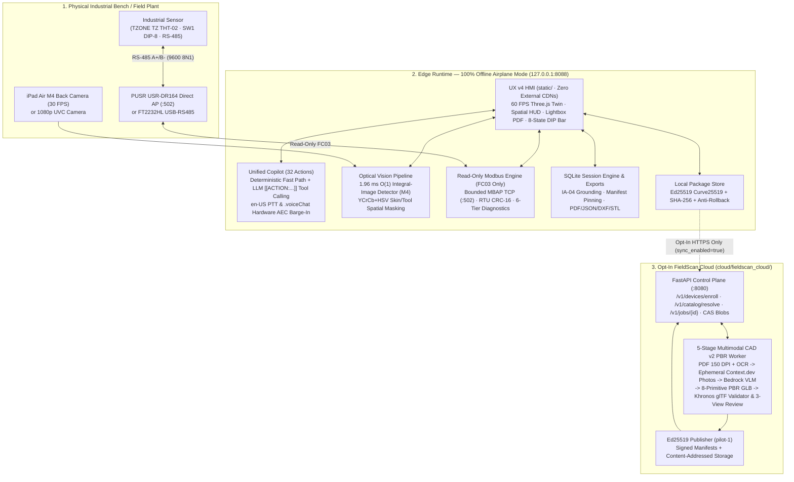
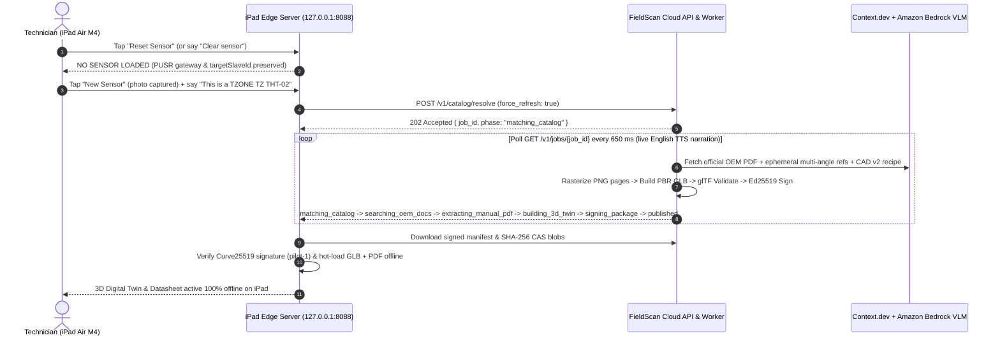

<h1 align="center">FieldScan</h1>

<p align="center">
  <strong>Offline-First Industrial 3D Digital Twin, Live Optical Vision, Voice Copilot &amp; Read-Only Modbus SCADA</strong><br/>
  <sub>Native iPad Air M4 (12 GB) Standalone App · Workstation Studio · Opt-In Ed25519-Signed Cloud CAD v2 PBR Pipeline</sub><br/><br/>
  Point an iPad at an industrial sensor in an air-gapped plant. FieldScan locks onto the physical hardware in <code>&lt; 2 ms</code>, manipulates a 1:1 interactive 3D Digital Twin and verified OEM datasheet by voice, reads live Modbus-RTU/TCP telemetry safely (read-only <code>FC03</code>), and — when opted in — synthesizes new sensor twins and manuals on demand from FieldScan Cloud.
</p>

<p align="center">
  
  <br/><sub>FieldScan UX v4 HMI: real-time optical SW1 DIP-8 lock with spatial HUD (left), synchronized 60 FPS Three.js exploded 3D Digital Twin (right), read-only Modbus SCADA indicators &amp; Airplane Mode socket guard (top), and hands-free voice copilot controls (bottom).</sub>
</p>

<p align="center">
  <a href="scripts/audit_no_regressions.py"></a>
  <a href="tests/"></a>
  <a href="cloud/tests/"></a>
  <a href="ios/FieldScanM4/"></a>
  <a href="SECURITY.md"></a>
  <a href="SECURITY.md#1-operational-safety-boundaries-industrial-pilot-gate"></a>
  <a href="ios/FieldScanM4/FieldScanVisionDetector.swift"></a>
  <a href="https://www.python.org/"></a>
  <a href="LICENSE"></a>
</p>

<p align="center">
  <a href="#capabilities-at-a-glance"><strong>Capabilities</strong></a> ·
  <a href="#1-system-architecture">Architecture</a> ·
  <a href="#2-zero-to-hero-cloud-onboarding">Cloud Onboarding</a> ·
  <a href="#3-core-engineering-subsystems">Subsystems</a> ·
  <a href="#4-quickstart">Quickstart</a> ·
  <a href="#5-verification--hardware-parity">Verification</a> ·
  <a href="#6-explicit-limitations--operational-boundaries">Limitations</a> ·
  <a href="#7-repository-structure">Repository</a>
</p>

> [!TIP]
> **Launch locally in two commands (100% offline, zero external CDNs):**
> ```bash
> uv sync && uv run uvicorn fieldscan.server:app --host 127.0.0.1 --port 8088
> ```
> Open `http://127.0.0.1:8088/` for the full Three.js 3D Digital Twin, optical HUD, 9-page verified datasheet viewer, and read-only Modbus SCADA workspace. For the native iPad Air M4 build, run `./scripts/build_ipad_m4_app.sh --unsigned`.

> [!IMPORTANT]
> **Industrial Safety Invariant:** FieldScan launches in **100% Air-Gapped Offline Mode** (`sync_enabled = false`, `0` WAN requests, iPad loopback strictly bound to `127.0.0.1:8088`) and enforces a **Read-Only Pilot Modbus Gate** (`FC03` only, `0` live bus writes, strict isolation between visual DIP-8 switch previews and the operator-authorized `targetSlaveId`). See [SECURITY.md](SECURITY.md).

---

## Capabilities at a Glance

| Capability | Status | Where to Verify |
|---|---|---|
| **Standalone Native iPad Air M4 App (12 GB)** — Embedded `NWListener` server, Metal VLM (`Qwen3-VL-4B` / FoundationModels), 30 FPS `AVFoundation` camera, `NWConnection` Modbus TCP (`:502`) & 60 FPS `WKWebView` CAD studio | ✅ Delivered | [`ios/FieldScanM4/`](ios/FieldScanM4/) · [`build_ipad_m4_app.sh`](scripts/build_ipad_m4_app.sh) |
| **Zero-to-Hero Cloud Sensor Onboarding** — Clean-slate workspace reset (preserving fixed PUSR gateway), live photo + voice/text identification, 6-phase job progress, Ed25519 (`pilot-1`) + SHA-256 verification & instant offline hot-load | ✅ Delivered | [`FieldScanCatalogClient.swift`](ios/FieldScanM4/FieldScanCatalogClient.swift) · [`cloud/fieldscan_cloud/worker.py`](cloud/fieldscan_cloud/worker.py) |
| **5-Stage Multimodal Cloud CAD v2 PBR Pipeline** — OEM PDF 150 DPI rasterization + OCR, ephemeral `Context.dev` multi-angle photo harvesting, Amazon Bedrock Mantle/Converse VLM recipe synthesis, 8-primitive glTF 2.0 PBR `.glb` generation & Khronos validator review | ✅ Delivered | [`cloud/fieldscan_cloud/twin/`](cloud/fieldscan_cloud/twin/) · [`test_multimodal_cad_pipeline.py`](cloud/tests/test_multimodal_cad_pipeline.py) |
| **32-Action Unified Copilot & Open-Ended LLM Tool Calling** — 1:1 Swift/Python action registry (`show`/`explain`/`propose`/`apply`), validated `[[ACTION:...]]` directives, sequential UI receipts (`/api/copilot/action_ack`) & monotonic `scene_generation` fencing | ✅ Delivered | [`FieldScanCopilotRegistry.swift`](ios/FieldScanM4/FieldScanCopilotRegistry.swift) · [`copilot_registry.py`](src/fieldscan/copilot_registry.py) |
| **Hands-Free LIVE Voice (`.voiceChat` AEC Barge-In) & Push-to-Talk** — Instant TTS interruption, stuck-state auto-recovery, 2.2 s echo filter & CoreAudio serial-queue deadlock guard | ✅ Delivered | [`StandaloneFieldScanServer.swift`](ios/FieldScanM4/StandaloneFieldScanServer.swift) · [`FieldScanSessionEngine.swift`](ios/FieldScanM4/FieldScanSessionEngine.swift) |
| **60 FPS Three.js Digital Twin & `< 2 ms` Optical Vision** — Parametric + Cloud glTF 2.0 PBR twins (`Solid`/`X-Ray`/`Explode`/`Rotate`/DIP-8 rockers), `1.96 ms` M4 integral-image carpet-proof detector & YCrCb+HSV hand/tool masking | ✅ Delivered | [`static/app.js`](static/app.js) · [`FieldScanVisionDetector.swift`](ios/FieldScanM4/FieldScanVisionDetector.swift) |
| **Read-Only Pilot Modbus-TCP (`PUSR USR-DR164 :502`) & Modbus-RTU (`FT2232HL`)** — AP-first 1-tap PUSR setup, bounded 4096 B MBAP parser, CRC-16 (`0xA001`), `0x7FFF` probe-fault sentinel, 6-tier link diagnostics & bus-target isolation | ✅ Delivered | [`ModbusTCPClient.swift`](ios/FieldScanM4/ModbusTCPClient.swift) · [`modbus_tcp.py`](src/fieldscan/modbus_tcp.py) · [`modbus_rtu.py`](src/fieldscan/modbus_rtu.py) |
| **Authoritative SQLite Sessions, `IA-04` Grounding & Compliance Exports** — Pinned manifests, explicit confirmation (`DAT-03`/`DAT-04`), zero-false-claim grounding filter & `.PDF` / `.JSON` / `.DXF` / `.STL` / `.ZIP` sign-off dossiers | ✅ Delivered | [`session_engine.py`](src/fieldscan/session_engine.py) · [`cad_builder.py`](src/fieldscan/cad_builder.py) · [`escalator.py`](src/fieldscan/escalator.py) |
| **Permanent Anti-Regression, Acyclic DAG & English-Only Audit Gate** — Automated verification across Python DAG, 338 English-only source files, 32/32 SHA-256 `BundleResources` & Swift parity contracts | ✅ Delivered | [`audit_no_regressions.py`](scripts/audit_no_regressions.py) · [`run_swift_contract_tests.swift`](scripts/run_swift_contract_tests.swift) |

<details>
<summary><strong>All Engineering Documentation &amp; Runbooks</strong></summary>

| Document | Scope |
|---|---|
| [`ARCHITECTURE.md`](ARCHITECTURE.md) | Complete Edge-to-Cloud architecture, Python↔Swift parity table, state machines & data contracts |
| [`SECURITY.md`](SECURITY.md) | Threat model, air-gapped network boundaries, Read-Only Modbus pilot safety & Ed25519 trust envelope |
| [`CONTRIBUTING.md`](CONTRIBUTING.md) | Local dev setup, mandatory pre-PR verification gates & 100% English source policy |
| [`docs/01_HARDWARE_USB_CAMERA_GLUE.md`](docs/01_HARDWARE_USB_CAMERA_GLUE.md) | UVC 1080p bench camera, optical framing & skin/tool masking notes |
| [`docs/02_LIQUID_LFM3_LLAMA_CPP_GLUE.md`](docs/02_LIQUID_LFM3_LLAMA_CPP_GLUE.md) | Local `llama.cpp` VLM (`Qwen3-VL-4B` / `LFM3`) & Piper English TTS integration |
| [`docs/03_PDF_TO_THREEJS_CAD_GLUE.md`](docs/03_PDF_TO_THREEJS_CAD_GLUE.md) | Datasheet blueprint geometry to 1:1 Three.js CAD rig & `.DXF`/`.STL` export |
| [`docs/04_VOICE_AND_OFFLINE_OUTBOX_GLUE.md`](docs/04_VOICE_AND_OFFLINE_OUTBOX_GLUE.md) | Offline voice loop & store-and-forward `.ZIP`/`.EML` sign-off packaging |
| [`docs/06_MODBUS_RS485_LIVE_REPAIR_GLUE.md`](docs/06_MODBUS_RS485_LIVE_REPAIR_GLUE.md) | RS-485 Modbus-RTU / MBAP TCP framing, CRC-16 & 4-stage guided repair workflow |
| [`docs/08_IPAD_AIR_M4_12GB_NATIVE_APP_GLUE.md`](docs/08_IPAD_AIR_M4_12GB_NATIVE_APP_GLUE.md) | Native iPad Air M4 12 GB unified memory budget, Xcode entitlements & USB-C deployment |
| [`docs/09_BASELINE_AND_CAPABILITY_MATRIX.md`](docs/09_BASELINE_AND_CAPABILITY_MATRIX.md) | Contract v2.1.0 baseline & platform capability matrix |
| [`docs/10_BENCH_SETUP_EVENT_RUNBOOK_AND_TEST_MATRIX.md`](docs/10_BENCH_SETUP_EVENT_RUNBOOK_AND_TEST_MATRIX.md) | Field bench setup, PUSR AP-first topology & acceptance matrix |
| [`docs/12_CLOUD_CATALOG_CONTRACT_AND_RUNBOOK.md`](docs/12_CLOUD_CATALOG_CONTRACT_AND_RUNBOOK.md) | FieldScan Cloud API specification, Ed25519 signing & Boat.dev deployment runbook |

</details>

---

## 1. System Architecture

FieldScan separates **air-gapped plant execution (Edge)** from **opt-in sensor knowledge synthesis (Cloud)** using a fail-closed cryptographic package boundary. See [`ARCHITECTURE.md`](ARCHITECTURE.md) for state machines, module graphs, and protocol schemas.



---

## 2. Zero-to-Hero Cloud Onboarding

When an operator encounters an unlisted sensor in the field, FieldScan supports a **clean-slate workspace reset** (wiping active sensor profiles while preserving the fixed PUSR gateway) followed by live voice/photo Cloud onboarding:



---

## 3. Core Engineering Subsystems

### Unified Copilot Action Registry & Local LLM Tool Calling
- **1:1 Swift ↔ Python Registry ([`FieldScanCopilotRegistry.swift`](ios/FieldScanM4/FieldScanCopilotRegistry.swift), [`copilot_registry.py`](src/fieldscan/copilot_registry.py)):** Exposes 32 strictly bounded actions across `twin.*`, `manual.*`, `camera.*`, `config.*`, `catalog.*`, `session.*`, and `help.*`, cleanly separating `show`, `explain`, `propose`, and `apply` intents.
- **Open-Ended LLM Control:** Injects the live action manifest into the on-device LLM prompt so natural requests (*"Show me the rear cable gland"*, *"Turn the 3D model around"*, *"Open the datasheet where the pins are"*, *"Clear sensor"*) emit validated `[[ACTION:<action_id>|{json}]]` directives, execute sequentially in `COPILOT_ACTION_HANDLERS`, and report verified visual completion via `/api/copilot/action_ack`.

### 5-Stage Cloud Multimodal CAD v2 PBR Pipeline ([`cloud/fieldscan_cloud/`](cloud/fieldscan_cloud/))
1. **Stage 1 — OEM PDF Rasterization & OCR:** Renders every datasheet page at 150 DPI PNG (`<= 1200 px`), reuses rasterized pages for Tesseract OCR, records `image_path` in `docs/index.json`, and enforces `<= 256` artifacts / `<= 120 MB`.
2. **Stage 2 — Ephemeral Multi-Angle Reference Harvester:** Queries `Context.dev` with manufacturer/model anti-contamination filters, SSRF-safe HTTPS downloads, and strict OEM domain allowlisting. Harvested images live **only** in ephemeral `staging/<job_id>/ref_images/` and are unconditionally deleted on completion — zero external photos or URLs enter CAS, manifests, or `.glb` files.
3. **Stage 3 — Provider-Agnostic VLM Synthesis:** Supports **Amazon Bedrock Mantle**, **Amazon Bedrock Converse**, OpenAI-compatible, Gemini, and Anthropic endpoints with automatic contact-sheet image-cap tiling (`_pack_images_to_limit`) and token telemetry.
4. **Stage 4 — Universal CAD v2 PBR Generator:** Compiles 8 parametric primitives (`lathe_profile`, `extruded_polygon`, `slotted_cylinder`, `hex_prism`, `rounded_box`, `tube_path`, `pattern`, `composite_part`) into glTF 2.0 `.glb` assets with real PBR materials, embedded procedural labels, and crease-angle normals.
5. **Stage 5 — Validation, Visual Review & Ed25519 Signing:** Validates with Khronos `gltf_validator` (`0` errors), renders headless 3-view CPU projections (`iso`, `side`, `exploded`) for automated VLM review, and signs the immutable package envelope with Ed25519 (`pilot-1`).

### Read-Only Pilot Modbus SCADA & AP-First PUSR Connectivity
- **1-Tap Direct AP Setup:** Auto-discovers `PUSR USR-DR164` (`10.10.100.254:502`) over direct Wi-Fi AP or private LAN, surfaces two-layer Amber/Green link state (`Gateway Reachable` vs `Sensor Validated`), and provides 6-tier unified diagnostics with chart gap breaks (`spanGaps: false`).
- **Strict Pilot Safety:** Enforces `FC03` read-only polling, rejects `:5502` raw RTU-over-TCP mismatch, validates `TxID`/`UnitID`/generation correlation, decodes signed `0.1 °C` / `0.1 %RH` values plus `0x7FFF` open-probe fault sentinels, and strictly isolates simulated DIP-8 previews from the authorized Modbus slave address.

---

## 4. Quickstart

### 1. macOS / Linux Workstation (Offline Studio)
```bash
# Install Python dependencies via uv
uv sync

# (Optional) Download local GGUF VLM + llama.cpp + Piper en_US voice into ./vendor/
./scripts/download_assets.sh

# Launch the full offline workstation (HTTP :8088 + optional USB-C iPad HTTPS :8443)
./scripts/start_all.sh --usb-ipad
# Or run FastAPI directly without downloading GGUF weights:
uv run uvicorn fieldscan.server:app --host 127.0.0.1 --port 8088
```

### 2. Native iPad Air M4 (12 GB RAM) App
```bash
# Sync BundleResources, run anti-regression audit, typecheck all 18 Swift files & build arm64-apple-ios
./scripts/build_ipad_m4_app.sh --unsigned

# Deploy to physical iPad Air M4 via Xcode (Clean Build Shift+Cmd+K -> Run Cmd+R)
open -a Xcode ios/FieldScanM4.xcodeproj
```

### 3. FieldScan Cloud Backend & Worker (`cloud/`)
```bash
# Requires poppler-utils (pdfinfo/pdftoppm) and tesseract-ocr
cd cloud
uv sync
cp deploy/api.env.example .env
uv run pytest -q
```

### 4. Full Verification & Anti-Regression Gate
```bash
uv run python scripts/sync_manifest.py --sync-bundle --verify
node --check static/app.js
uv run python scripts/audit_no_regressions.py
uv run pytest -q
```

---

## 5. Verification & Hardware Parity

Every claim below corresponds to executed automated tests or live hardware runs recorded in this repository:

| Verification Gate / Hardware Proof | Target Environment | Measured Result | Status |
|---|---|---|---|
| **Edge + Copilot + Cloud Catalog Matrix (`pytest`)** | macOS `arm64` (Python 3.12) | `97 passed, 0 failed` (incl. Swift CLI contracts Sections 1–12c) | **PASS** |
| **Cloud 5-Stage CAD v2 PBR + Auth + Worker (`cloud/tests/`)** | Linux `x86_64` (`bx_a3burasy`, Python 3.12) | `20 passed, 0 failed` | **PASS** |
| **Permanent Anti-Regression & English-Only Audit** | `scripts/audit_no_regressions.py` | `338` English-only files, `19` acyclic Python modules, `0` errors | **PASS** |
| **iOS `BundleResources` Integrity** | `scripts/sync_manifest.py --verify` | `32 / 32` files, `100%` SHA-256 parity | **PASS** |
| **Native iPad Air M4 Compilation** | Xcode `arm64-apple-ios` (Release) | `18 / 18` Swift files typechecked, `** BUILD SUCCEEDED **` | **PASS** |
| **Real Physical Hardware Telemetry** | `PUSR USR-DR164 V1.0.15` + `TZ THT-02` | Direct AP `10.10.100.254:502` live read-only `FC03` on Slave `#1` | **VERIFIED** |
| **Live Cloud HTTPS Roundtrip (Zero-to-Hero)** | iPad Client ↔ `bx_a3burasy` Cloud API | `25.09 s` end-to-end (`matching_catalog` -> `published`), Ed25519 `pilot-1` + `23` artifacts verified | **VERIFIED** |
| **On-Device Optical Detector Latency** | Apple iPad Air M4 (`FieldScanVisionDetector.swift`) | `1.96 ms/frame` integral-image carpet-proof lock | **VERIFIED** |

---

## 6. Explicit Limitations & Operational Boundaries

1. **Read-Only Pilot Scope:** Live Modbus writes (`0x06` baud-rate writes, register writes) are intentionally disabled by policy (`pilot_writes_enabled = false`) for safety; DIP-8 addressing is physical hardware configuration guided visually by the 3D Digital Twin.
2. **Advisory Field Assistant (Not Safety-Certified):** FieldScan is a field-service engineering and inspection copilot, not a SIL-rated or metrologically certified calibration instrument. All physical actions require technician verification (`DAT-03`/`DAT-04`).
3. **Cloud CAD Synthesis Quality Depends on Source Material:** Verified sensor fixtures compile deterministically into multi-material PBR `.glb` assemblies; newly discovered sensors rely on OEM datasheet clarity and upstream VLM synthesis and degrade gracefully to `docs_only` when insufficient dimensional geometry is available.
4. **Local VLM Weights Excluded from Git:** Large GGUF model weights (`vendor/`) and runtime SQLite databases (`data/`) are intentionally git-ignored; download local models via `./scripts/download_assets.sh` when running workstation VLM inference offline.

---

## 7. Repository Structure

```text
FieldScan/
├── README.md                                  # Project overview, architecture diagrams, quickstart & verification
├── ARCHITECTURE.md                            # Deep Edge-to-Cloud architecture, parity matrix & state machines
├── SECURITY.md                                # Threat model, Read-Only Modbus safety & Ed25519 trust model
├── CONTRIBUTING.md                            # Contributor setup, mandatory verification gates & code standards
├── LICENSE                                    # MIT License
├── pyproject.toml & uv.lock                   # Deterministic Python 3.10–3.12 Edge environment
│
├── .github/
│   ├── ISSUE_TEMPLATE/                        # Structured YAML bug report & feature request forms
│   └── PULL_REQUEST_TEMPLATE.md               # Verification & safety checklist
│
├── ios/                                       # Native Standalone iPad Air M4 (12 GB) Swift App (Xcode)
│   ├── FieldScanM4.xcodeproj/                 # arm64-apple-ios project (com.fieldscan.tht02.ipadm4)
│   └── FieldScanM4/                           # 18 Swift modules (Server, CopilotRegistry, Vision, Twin, ModbusTCP, PackageStore, Camera, LLM)
│
├── src/fieldscan/                             # Modular Python Workstation Backend (19 Acyclic Modules)
│   ├── server.py                              # FastAPI studio server (:8088 / :8443) & unified REST endpoints
│   ├── copilot_registry.py                    # 32-action bounded registry & LLM [[ACTION:...]] directive parser
│   ├── lfm_engine.py & scene_and_chat_router.py # On-device VLM, ASR, Piper TTS & multimodal intent router
│   ├── twin_controller.py & manual_navigator.py # Deterministic 3D twin controller & verified datasheet resolver
│   ├── video_scanner.py                       # 30 FPS OpenCV scanner, skin/tool masking & DIP-8 macro
│   ├── modbus_tcp.py & modbus_rtu.py          # Read-only FC03 PUSR MBAP TCP (:502) & FT2232HL RTU master
│   ├── session_engine.py & offline_guard.py   # SQLite session FSM, IA-04 grounding & Airplane Mode socket guard
│   ├── catalog_store.py & catalog_client.py   # Ed25519 + SHA-256 package verifier & opt-in Cloud client
│   └── cad_builder.py & escalator.py          # Parametric .DXF/.STL generator & offline .ZIP/.EML packager
│
├── cloud/                                     # Opt-In FieldScan Cloud Control Plane & 5-Stage CAD v2 Worker
│   ├── fieldscan_cloud/
│   │   ├── api.py & config.py                 # FastAPI enrollment, /v1/catalog/resolve, /v1/jobs/{id} & assistant proxy
│   │   ├── worker.py                          # Async 6-phase job runner & artifact budget enforcement
│   │   ├── documents/pipeline.py              # Stage 1: 150 DPI PDF rasterization & Tesseract OCR
│   │   ├── sources/                           # Stage 2: Context.dev client, OEM registry & ephemeral image harvester
│   │   ├── twin/                              # Stages 3–5: Bedrock VLM synthesizer, CAD v2 PBR GLB generator & validator
│   │   └── publication/                       # Ed25519 (pilot-1) manifest signing & CAS object storage
│   ├── fixtures/tht02_v1_1/                   # Verified declarative CAD v2 recipe & OEM source metadata
│   ├── deploy/                                # Systemd units & sanitized env examples
│   └── tests/                                 # 20 automated Cloud API, auth, worker & multimodal CAD pipeline tests
│
├── static/                                    # Air-Gapped UX v4 HMI (Zero External CDNs)
│   ├── index.html, styles.css & app.js        # Responsive Portrait/Landscape studio, Three.js CAD rig, CV HUD & voice loop
│   └── vendor/                                # Bundled Three.js v0.170, OrbitControls, STLExporter, uPlot, Lucide & Open Props
│
├── knowledge/                                 # Verified specs, manual index, SHA-256 resource manifest & golden contracts
├── assets/                                    # Official TZ THT-02 datasheet PDF & pre-rendered offline pages
├── scripts/                                   # Build, BundleResources sync, permanent audit gate & Swift contract runner
├── tests/                                     # 97 Edge, Copilot, Cloud Catalog & Swift parity tests
└── docs/                                      # Technical glue guides (01..13) & Retina HMI visuals
```
